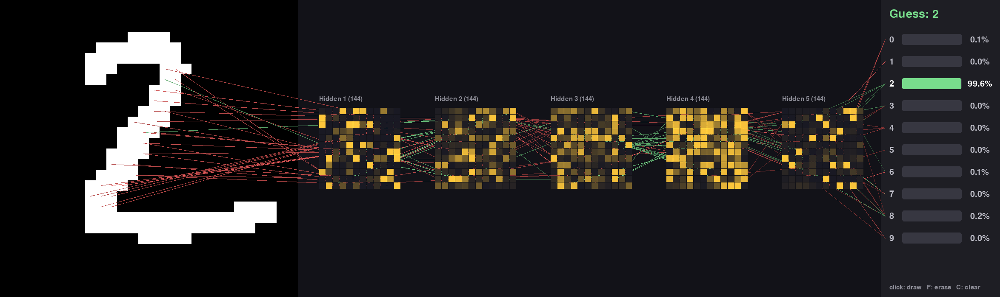

# neural-net

A neural network written from scratch in NumPy (`nn.py`), shared by two apps.

## Layout

- `nn.py`: shared neural network.
- [`digit/`](digit/README.md): MNIST digit recognizer.
- [`text/`](text/README.md): character-level language model on Tiny Shakespeare.



## Setup

```sh
uv sync
```

## Run

```sh
uv run python digit/main.py
uv run python text/main.py
```

Use `--retrain` to retrain.

## Tests

```sh
uv run pytest
```
