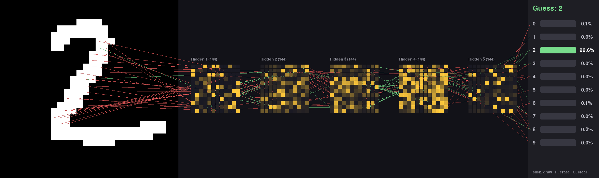
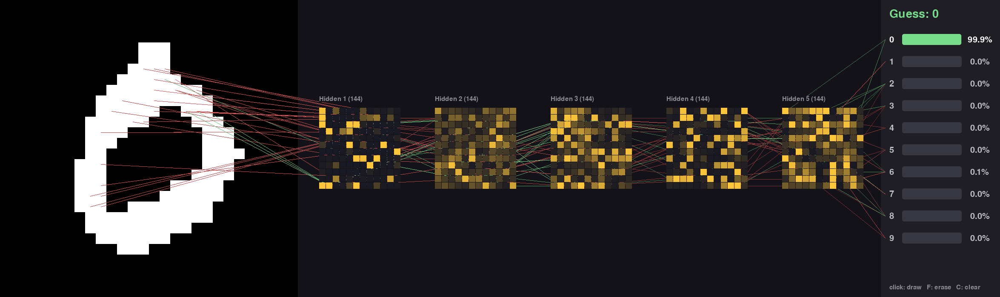
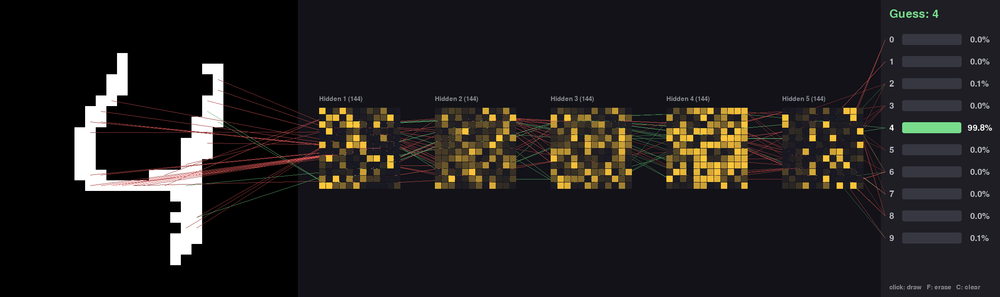
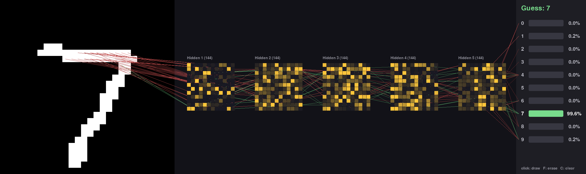

# Digit recognizer

A neural network written from scratch in NumPy that recognizes handwritten
digits. You draw a digit with the mouse and watch every layer of the network
react in real time.

No ML frameworks are used: the forward pass, backpropagation and gradient
descent are all hand-written in [`nn.py`](../nn.py). It's trained on
[MNIST](https://huggingface.co/datasets/ylecun/mnist) (60,000 handwritten digits).



## What you're looking at

- **Left:** your drawing, on a 28 × 28 grid (the same size as MNIST images).
- **Middle:** the 5 hidden layers. Each square is one layer of 144 neurons in a
  12 × 12 grid; a neuron is dark when inactive and bright yellow when fully
  active.
- **Lines:** for each step (pixels → hidden 1 → … → hidden 5 → digits), the 30
  connections with the most influence right now (weight × how active the
  source neuron is). **Green** pushes the next neuron up, **red** pushes it
  down, and brighter means stronger.
- **Right:** the network's guess and how confident it is in each digit.

Hidden 1 lights up very differently for different digits, since its neurons
respond to specific strokes. Deeper layers have many more neurons active, and
the difference between digits becomes a pattern spread across the whole layer.

| | |
|---|---|
|  |  |
|  |  |

## Stats

| | |
|---|---|
| Test accuracy (10,000 unseen MNIST digits) | **97.37%** (263 wrong) |
| Architecture | 784 → 144 → 144 → 144 → 144 → 144 → 10 |
| Parameters | 198,010 |
| Training | 50 epochs, mini-batches of 32, learning rate 1.0 |
| Training time | ~2.5 min on CPU (Intel i5-12400F) |
| Rendering | ~7 ms per frame (runs at 60 fps) |

Accuracy per digit on the test set:

| Digit | 0 | 1 | 2 | 3 | 4 | 5 | 6 | 7 | 8 | 9 |
|---|---|---|---|---|---|---|---|---|---|---|
| Accuracy (%) | 99.2 | 98.3 | 98.0 | 98.1 | 96.7 | 96.3 | 98.4 | 96.6 | 96.7 | 95.1 |

Most common mistakes: 4 read as 9 (15 times), 5 as 3 (12), 7 as 3 (11),
9 as 7 (11) and 9 as 8 (10).

### Choosing the network size

Accuracy on 10,000 held-out training images (validation) for different sizes:

| Hidden layers | Validation accuracy |
|---|---|
| 2 × 16 | 94.5% |
| 2 × 64 | 97.4% |
| 2 × 256 | 98.2% |
| 5 × 128 | 97.0% |
| 5 × 144 | 97.4% (test) |
| 5 × 256 | ~10% (does not learn) |

The most accurate size was 2 layers of 256. This project uses 5 layers to make
the visualization more interesting, at the cost of about 1 point of accuracy.
With sigmoid neurons, deep and wide doesn't train: in 5 × 256 the learning
signal reaching the first layer is under 0.5% of what the last layer gets
(the *vanishing gradient* problem), so it never gets past guessing.

## How it works

- **Neurons:** sigmoid activation, `sig(W · a + b)` from one layer to the next.
- **Cost:** squared error against a one-hot target (1 for the right digit, 0
  for the rest).
- **Training:** mini-batch stochastic gradient descent with backpropagation.
  Each step runs 32 images through the network as one matrix, averages their
  gradients and moves the weights downhill. The data is shuffled every epoch.
- **Starting weights:** random from a normal distribution scaled by
  1/√(inputs to the layer). Without that scaling, wide layers start with their
  sigmoids pinned at 0 or 1 and never learn.
- **Confidence:** the 10 sigmoid outputs are independent, so the percentages on
  screen are the outputs scaled to add up to 100%.

## Running it

Tested with Python 3.12.

```sh
uv sync
uv run python digit/main.py
```

Trained weights ship in `weights.npz`, so the window opens straight away.
Use `--retrain` to download MNIST and train from scratch (~2.5 min); the
result overwrites `weights.npz`.

**Controls:** left click to draw, hold **F** to erase, press **C** to clear.

The network size, learning rate and number of epochs are set at the top of
[`main.py`](main.py); the on-screen layout adapts to whatever you choose.
Changing the size needs `--retrain`.

## Files

- [`nn.py`](../nn.py): the neural network (forward pass, backprop, training,
  save/load).
- [`main.py`](main.py): loads or trains the network and runs the drawing window
  and visualization.
- `weights.npz`: trained weights (rewritten by `--retrain`; NumPy's zipped
  array format).
