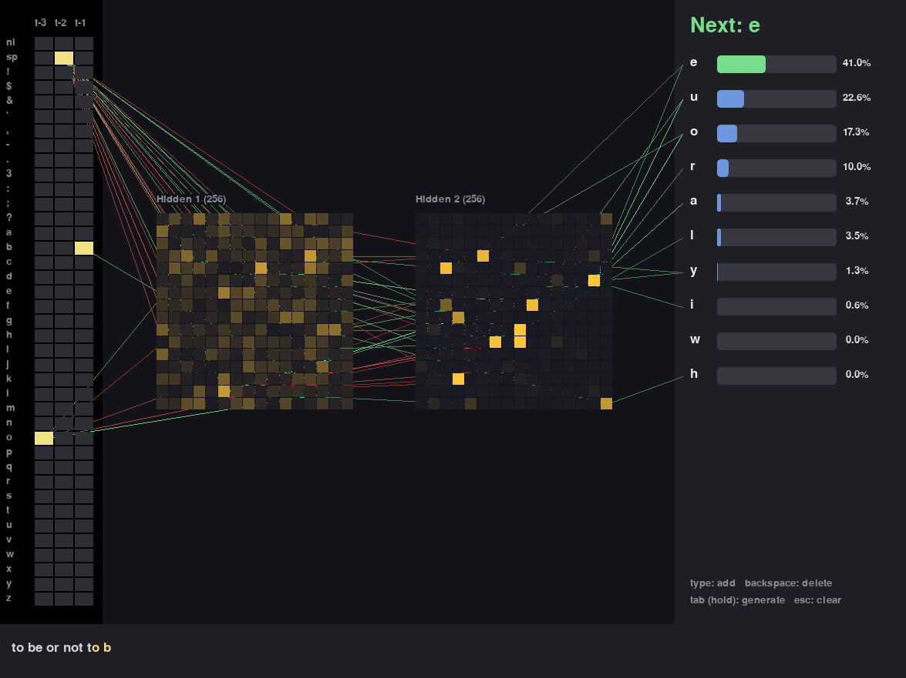
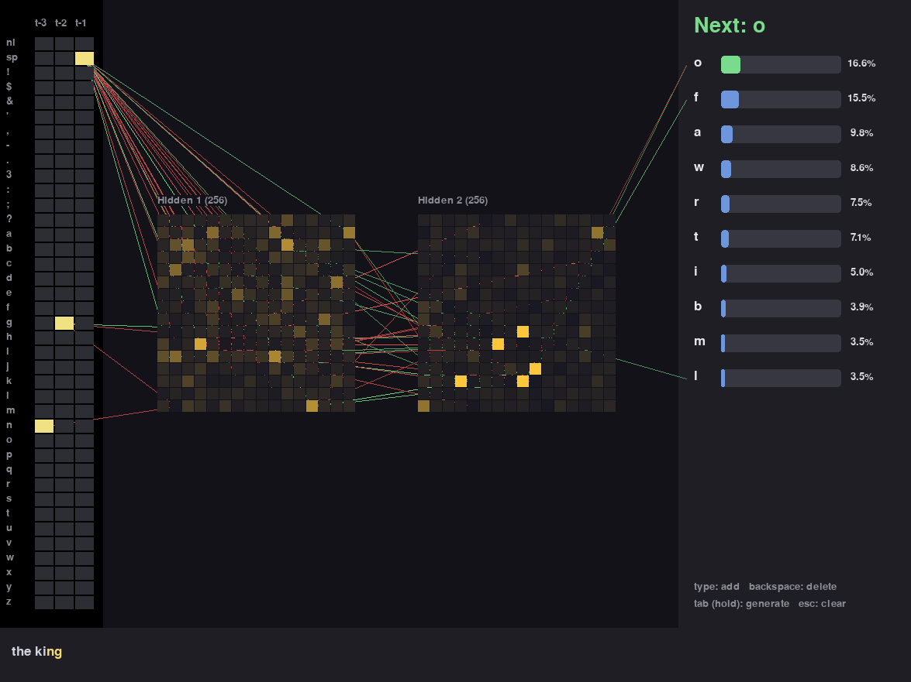

# Text predictor

A character-level language model written from scratch in NumPy. Type some text
and watch the network predict the next character. The forward pass,
backpropagation and gradient descent live in shared [`nn.py`](../nn.py), with no
ML framework.



## What you're looking at

- **Left:** one column per context position and one row per character. Yellow
  cells show the characters the network sees (`sp` is space, `nl` is newline).
- **Middle:** two 16 × 16 grids of sigmoid neurons. Dark means inactive; bright
  yellow means active. Green and red lines show the 30 strongest live
  connections per layer pair (weight × source activation); brighter means
  stronger. Connections to outputs outside the top 10 are omitted.
- **Right:** the ten most likely next characters and their probabilities.
- **Bottom:** the latest text, with the context highlighted in yellow.



## Stats

First 90% of lowercased Tiny Shakespeare for training, final 10% for validation;
each sample is a sliding window. The split is over windows, so their contexts
at the boundary overlap by two characters.

| | |
|---|---|
| Validation next-character accuracy | **37.23%** |
| Validation cross-entropy loss | 2.0681 |
| Architecture | 117 → 256 → 256 → 39 |
| Parameters | 106,023 |
| Training | 3 epochs, batch 256, learning rate 4.0 |
| Training time | 55.2 s on CPU |
| Draw frame | 2.37 ms, 100 offscreen frames (excluding frame cap) |

A 300-character continuation at temperature 0.8 (seed `the `):

```text
the gentle
of abies:
fortore fortaitent:
that cour rever'd to fadio:
would bear forty;
for he forduence friefore mean'd, for befor frenter ard of for ung me therem'd to mone! there and to her for that and sime fore rown,
and will pole,
fore are, and fells.
serve, see:
what ii:
to will on our will agle m
```

## How it works

Each context position is one-hot encoded over the sorted vocabulary; these
vectors are concatenated into the input. Sigmoid hidden layers feed a softmax
output trained with cross-entropy and mini-batch gradient descent. Training
stores character-index windows and encodes each batch on demand, avoiding a
large full one-hot matrix. Generation samples the output distribution after
applying temperature (lower is more deterministic).

`CONTEXT` at the top of [`main.py`](main.py) controls how many preceding
characters the model sees. `1` is a bigram model; larger values increase memory
use and input size. Missing context is padded on the left with spaces. Changing
context or vocabulary size automatically retrains incompatible saved weights.
The model knows only the fixed vocabulary from the training text.

## Running it

```sh
uv sync
uv run python text/main.py
```

The first run downloads [Tiny Shakespeare](https://github.com/karpathy/char-rnn/tree/master/data/tinyshakespeare),
caches it in `text/input.txt`, trains, and saves `text/weights.npz`. Later runs
load the weights; pass `--retrain` to train again. The download requires network
access on the first run.

**Controls:** type to add characters; Enter adds a newline; Backspace deletes;
hold Tab to generate about 10 characters per second; Esc clears the text.
Characters outside the vocabulary are ignored. The window starts with `the `.
